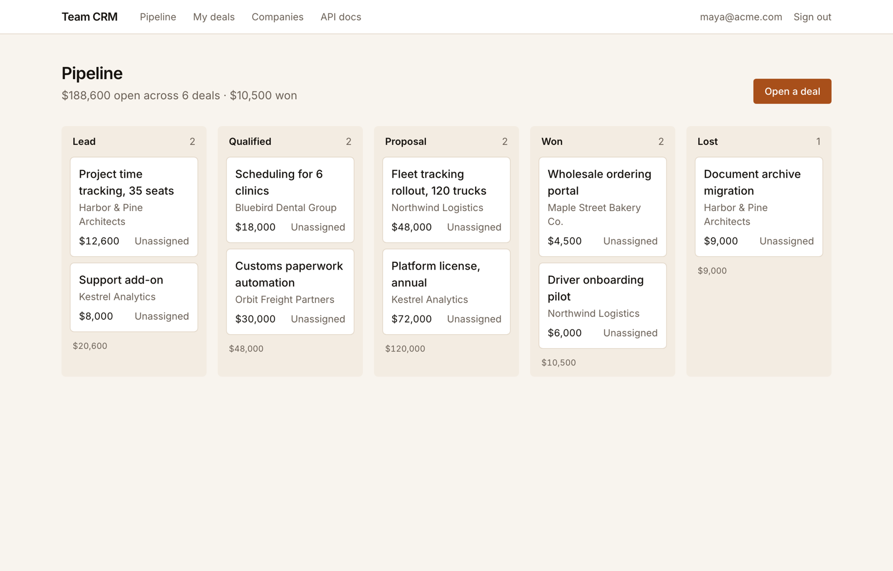

# Team CRM template for floo

A lightweight CRM for small sales, partnerships and account teams: track companies, their contacts, deals moving through your pipeline, and every call, email and note, all behind your team's sign-in.



## What you get

- **Sign-in for your team, with roles.** floo hosts the login. Any member can add and edit records; only admins can delete.
- **A pipeline you can read at a glance.** Deals grouped by stage (lead, qualified, proposal, won, lost), a company page with contacts, deals and an activity timeline, and a "My deals" view for each person.
- **Managed Postgres.** Tables and migrations are in the repo and run on every deploy.
- **An agent API.** Search companies, create and update contacts and deals, and log activity over a key-authenticated JSON API with a generated OpenAPI document, so an agent can log a call summary the moment a call ends.
- **Sample data on demand.** One command fills an empty database with realistic companies and deals.

## Deploy with your agent

Paste this into Claude Code, Codex or Cursor:

```text
Deploy the template at https://github.com/getfloo/team-crm-template on floo for me.
Follow https://getfloo.com/agents.md to create a floo-hosted project, replace its
starter code with this template's files (keep the project's [app] name in
floo.app.toml), push, and give me the live URL.
```

Or do it yourself: click **Use this template** on GitHub to create your own copy, then:

```sh
curl -fsSL https://getfloo.com/install.sh | bash
floo auth login
floo apps github connect <you>/<your-repo>
floo deploys watch
```

`connect` creates the app and deploys it. If floo has no access to the repository yet, it prints a link to install the floo GitHub App; finish that and run `connect` again. The app is named `team-crm` in `floo.app.toml`; change `name` there first if you want another name.

## Customize

Give your agent prompts like these:

- "Add a close date to deals and show deals closing this month at the top of My deals."
- "Log an activity automatically whenever a deal changes stage, authored by whoever changed it."
- "Add a CSV import on the Companies page for name, domain, contact name and contact email."
- "Add a `source` field to deals (referral, inbound, outbound) and show totals by source on the pipeline."
- "Write a script that reads my meeting notes and calls `POST /api/activities` with a summary for the matching company."

## Local development

```sh
npm install
floo dev --fixture-user you@example.com --fixture-role admin
```

`floo dev` runs the migrations, starts the app against your dev database, and prints an auth-proxied URL that signs you in as the fixture user. Open that URL once so you appear in the team list, then add sample data:

```sh
floo run --service web -- npm run seed
```

The seed only fills an empty database and spreads the sample deals across everyone who has signed in. It never runs on deploy. `npm test` runs type checks, lint and tests without a database.

## How it works

| Route | What it shows |
|---|---|
| `/` | Pipeline: every deal grouped by stage, with open and won totals |
| `/my-deals` | Deals owned by the signed-in person, in pipeline order |
| `/companies` | Search companies by name, domain or contact, and add a company |
| `/companies/[id]` | A company's deals, contacts and activity timeline, with forms to add and edit each |
| `/api-docs` | The API reference, for signed-in people |
| `/api/*` | The JSON API, for members' floo keys and app API keys |

**Roles.** floo sends each signed-in person's role as `admin` or `member`. Members create and edit everything. Delete buttons appear only for admins, and every delete action checks the role on the server.

**Data model.** `companies` have many `contacts` and `deals`. A deal has a title, a value in whole currency units, a stage, and an owner (a teammate, or unassigned). `activities` are notes, calls and emails on a company, optionally about one of its deals; each records its author from the signed-in identity or the API key. Deleting a company deletes its contacts, deals and activity. `users` caches everyone who has signed in, so deals can be assigned to them.

**API.** Call `/api` as yourself with your own floo key, or give a program an app API key with the `api` scope:

```sh
floo apps consumers create crm-agent
floo apps keys create crm-agent-key --consumer crm-agent --scope api
curl -H "Authorization: Bearer $KEY" "https://<your-app-url>/api/companies?q=northwind"
```

| Endpoint | Does |
|---|---|
| `GET /api/companies?q=` | Search companies by name, domain, or a contact's name or email |
| `POST /api/companies` | Create a company |
| `GET /api/companies/{id}` | A company with its contacts, deals and activity |
| `POST /api/contacts`, `PATCH /api/contacts/{id}` | Add or change a contact |
| `GET /api/deals?stage=&ownerEmail=` | List deals |
| `POST /api/deals`, `PATCH /api/deals/{id}` | Open or change a deal (stage, value, owner by email) |
| `POST /api/activities` | Log a note, call or email on a company or deal |

The full contract is at `/api/openapi.json`; hand an agent the app URL and a key and it can find the rest. The API cannot delete anything. `AGENTS.md` is the working guide for coding agents changing this app.

---

Built on [floo](https://getfloo.com): build internal software.
